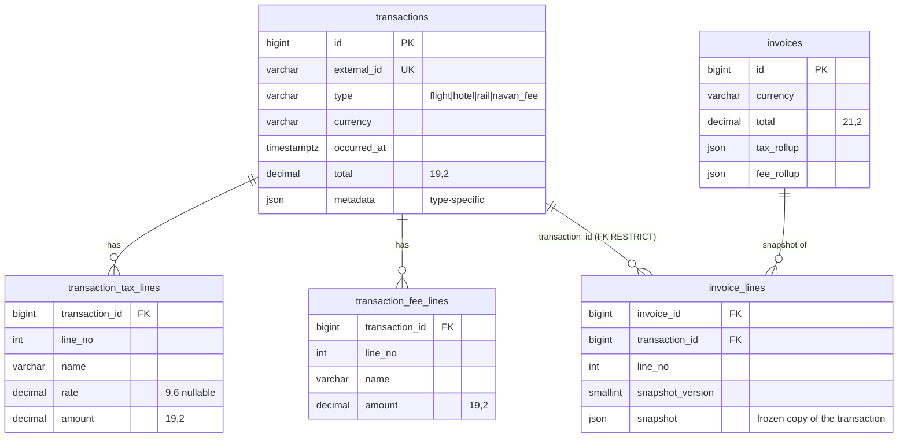

# Architecture

## Scope

The service is the system of record for already-structured travel transactions (`flight`, `hotel`, `rail`, `navan_fee`) and for invoices built from them. It has one job: store transactions safely and take frozen invoice snapshots of them.

It does **not** price bookings, calculate tax, convert currency, render PDFs, or call any external system.

The code is split into Spring MVC layers:

```
controller ──► service (interface) ──► service.impl ──► repository ──► H2 (file)
  HTTP only      contract the            rules,            Spring Data JPA
                 controller sees         DB transactions,  interfaces + entities
                                         locking
```

Controllers depend only on the `ITransactionService` and `IInvoiceService` interfaces. The `*ServiceImpl` classes hold the logic and the `@Transactional` boundaries, and can be swapped or mocked without touching the HTTP layer.

Persistence uses Spring Data JPA, with guard rails against its usual traps:
- **Flyway owns the schema.** `ddl-auto: none`; entities are mapped onto the tables, never used to generate them.
- **Two data layers: models and entities.** Services and the API work only with immutable models in the `model` package (`Transaction`, `Invoice`, …). Entities exist only in repositories and mappers. `open-in-view` is off, and `TransactionMapper`/`InvoiceMapper` convert entities to models before the transaction ends, so lazy loading never leaks into controllers or JSON.
- **Snapshot rows can't be rewritten.** `InvoiceLineEntity` is `@Immutable`: Hibernate can insert and delete it but never update it.
- **Errors surface where they're handled.** Writes use `saveAndFlush`, so constraint violations are raised inside the service's try/catch, not at some later commit.

| Responsibility | Where it lives |
|---|---|
| HTTP handling | `TransactionController`, `InvoiceController` |
| Transaction storage | `TransactionRepository` |
| Duplicate detection | `TransactionServiceImpl.create` + `UNIQUE(external_id)` |
| Invoice snapshot and rollups | `InvoiceSnapshotBuilder` (pure logic, no DB) + `InvoiceServiceImpl` |

## Tables and models



**Taxes and fees are separate child tables.** They are separate lists (VAT vs. YQ vs. booking fee) and must never be mixed, so each gets its own table with ordered rows (`line_no`). Tax lines have an optional `rate`; fee lines have no rate.

**Type-specific data goes in a JSON `metadata` column, validated against a typed Java model.** `TransactionMetadata` is a sealed interface with one immutable class per type (Lombok `@Value`):

| Type | Class | Required content |
|---|---|---|
| flight | `FlightMetadata` | `origin`, `destination`, `fare`, `coupons[]` (`flight_number`, `carrier`?, `from`, `to`, `departure`, `arrival`) |
| hotel | `HotelMetadata` | `name`, `address{street, city, country}`, `check_in`, `check_out`, `nights`, `room_rate_per_night`, `extras[]`? |
| rail | `RailMetadata` | `legs[]` (`origin`, `destination`, `departure`, `arrival`, `train_number`?, `class`?); a train change means two legs |
| navan_fee | `NavanFeeMetadata` | `fee_kind` (`trip_fee` \| `agent_call_fee`), `description`?, `related_external_id`? |

How metadata is handled on write and read:
- The request's `type` decides which class the `metadata` JSON is bound to.
- Bean Validation then checks that object.
- An unknown `type`, an unknown `fee_kind`, or empty/incomplete metadata returns **400**, so the database never holds a dummy or mismatched metadata blob.
- On read, the `type` column selects the metadata class again, so GET returns the same structure that was sent.

Why JSON rather than per-type child tables (`flight_coupons`, `rail_legs`, …):
- Nothing queries inside metadata.
- It is always read and written whole, together with its transaction.
- JSON keeps the schema to three transaction tables instead of eight.

If the service later needs to search by flight number or hotel city, those fields can be promoted to indexed columns or child tables without changing the API.

## `external_id` uniqueness and concurrent POSTs

`transactions.external_id` has a **unique constraint**, and that constraint is the only real guarantee. `TransactionServiceImpl.create` works in three steps:

1. **Fast path.** Look up `external_id` (an index lookup). If it exists, return **409** with `existing_id`. This handles normal client retries cheaply, and runs before metadata validation. That is why the fixture `duplicate_flight` (with `coupons: []`) gets 409, not 400.
2. **Insert in one DB transaction.** `saveAndFlush` writes the header, tax lines, fee lines, and metadata together inside a `TransactionTemplate`, so either everything persists or nothing does.
3. **Race path.** If two POSTs both pass step 1, the database rejects the second insert with a unique violation, or a lock timeout while waiting on the first. The service catches that, re-reads the winner's id, and returns **409** with `existing_id`.

This gives exactly one row and never a 500. It is verified by 8 parallel POSTs in `concurrentDuplicateCreateLeavesExactlyOneRow`. There is no application-level lock, no Redis, and ids are generated by the database (`IDENTITY`).

## Invoice snapshot

`POST /invoices` runs in one DB transaction:

1. Reject an id listed twice (**409**).
2. Load the transactions with `@Lock(PESSIMISTIC_WRITE)` (`SELECT … WHERE id IN (…) ORDER BY id FOR UPDATE`), which locks the rows in a fixed order to avoid deadlocks. Return **404** if any id is missing.
   - Then, still under those locks, return **409** `transaction_already_invoiced` if any of them is already on another invoice. A transaction is billed at most once; the unique constraint `uq_invoice_lines_transaction_id` enforces this in the database too.
3. `InvoiceSnapshotBuilder`:
   - All lines must share one currency, otherwise **409** `mixed_currency`.
   - Copy each transaction into an `InvoiceLine`: type, external_id, currency, occurred_at, total, tax_lines, fee_lines, metadata. When saved, each line is written in the storage format `InvoiceLineSnapshot`, which has its own tax and fee line types, separate from the API model.
   - **Tax rollup:** group by `(name, rate)`, treating 0.07 and 0.070 as the same rate, and sum the amounts.
   - **Fee rollup:** group the transactions' `fee_lines` by `name` and sum.
   - **Total:** sum of the transaction totals, using `BigDecimal`.
4. Store each line as **one JSON document** in `invoice_lines.snapshot`, and the rollups as JSON on `invoices`.

`GET /invoices/{id}` reads only `invoices` and `invoice_lines` and **never joins back to `transactions`**. Changing a transaction afterwards cannot change an existing invoice; `invoiceIsAFrozenSnapshot` changes the row directly in the database and checks the invoice still shows 220.00.

Rules that keep the snapshot honest:
- **Billed lock.** PATCH or DELETE on a transaction first takes `SELECT … FOR UPDATE` on that row, then checks `invoice_lines.transaction_id`. If the transaction is on any invoice, it returns **409** and changes nothing.
  - Invoice creation locks the same rows, so a transaction can't be edited while it is being invoiced.
  - `ON DELETE RESTRICT` on `invoice_lines.transaction_id` is a database-level backstop against deleting a billed transaction.
- **PATCH invoice.** Lock the invoice row, lock the new transactions, rebuild, then swap the lines and header in one DB transaction. Any 404 or 409 rolls everything back, so the invoice stays unchanged.
- **DELETE invoice.** Cascades to its lines, leaves the transactions untouched, and makes those transactions editable again.

## Money

- Amounts are stored as `DECIMAL(19,2)`: **scale 2**, in major units (e.g. 220.00 EUR). Tax rates are `DECIMAL(9,6)`. The invoice `total` is `DECIMAL(21,2)`, so 100 maximum-size transaction totals still fit.
- Java uses `BigDecimal` everywhere. No `float` or `double` is involved.
- Input with more than 2 real decimal places is rejected with **400**; it is never silently rounded. Trailing zeros are fine everywhere (`total`, tax/fee `amount`, metadata money): `220.000` is stored as `220.00`, `220.001` is rejected.
- Negative amounts are rejected with **400**, everywhere money appears: `total`, tax and fee `amount`, and money inside `metadata` (`fare`, `room_rate_per_night`, hotel `extras`). Refunds and credits aren't in the brief; they would be modelled as their own transaction type rather than as negative totals.
- Money inside `metadata` is also normalised to scale 2 when read (`180` → `180.00`), so a transaction, its GET response and any new invoice snapshot all show the same format.
- Only addition happens (totals and rollups), so no rounding mode is needed.
- JSON output writes money as strings (`"685.70"`), so neither clients nor the JSON snapshot columns can lose precision.
- The fixed scale of 2 assumes currencies with 2 minor units (see the assumptions below).

## High volume

| Pressure | What fails first without care | What this service does |
|---|---|---|
| Duplicate POST storms and retries | Check-then-insert races create two rows | `UNIQUE(external_id)` decides. The losing request gets 409 with `existing_id`, not a 500. The fast-path check is a single index lookup. Only real constraint violations (SQLState `23xxx`) map to 409; any other database data error is a 500, so it never looks retryable. |
| Concurrent PATCH on one transaction | Interleaved writes leave a half-replaced `tax_lines`/`fee_lines` list | `SELECT … FOR UPDATE` serializes writers per row. Header and line replacement commit together. A lock wait over 10 s returns 409 `concurrent_modification` (safe to retry). Last write wins, and no write is ever partly applied. |
| PATCH or DELETE racing invoice creation | A transaction changes after being billed | Both paths lock the same transaction rows, and the billed check runs under that lock. |
| Large lists | `SELECT *` or `OFFSET` scans grow with table size | **Cursor pagination** (`WHERE id > :after ORDER BY id`, limited to the page size by a `Pageable` with no COUNT query), which costs the same on any page. `limit` is capped at 100 (larger values get 400). Lists use JPQL `select new …Summary(…)` projections without lines or metadata: one query per page, no extra query per row. |
| "Is this transaction billed?" on every PATCH/DELETE | Full scan of `invoice_lines` | `uq_invoice_lines_transaction_id` (unique index) |
| Invoice over many transactions | One request locks thousands of rows `FOR UPDATE`; tax/fee lines load with 2 extra queries per transaction | `transaction_ids` is capped at **100** (more gets 400). Tax and fee lines use `@BatchSize(100)`, so a full invoice loads its lines in one query per line table rather than one per transaction. |

Indexes:
- Primary keys on every table.
- `uq_transactions_external_id`.
- `(transaction_id, line_no)` unique on the tax and fee line tables, which serves "load lines for these transactions".
- `(invoice_id, transaction_id)` unique on `invoice_lines`, which serves "load an invoice's lines" and blocks duplicate lines.
- `uq_invoice_lines_transaction_id` (unique; added in `V2`): one invoice per transaction, and the "is this billed?" lookup.

**What breaks first in this exact setup:** the database. Embedded H2 in file mode allows a single application process and has limited write concurrency, so it is the first ceiling, not the application code. The production step is Postgres plus several stateless app instances. The constraints, row locks, and cursor queries carry over unchanged, and Hibernate's dialect handles the JSON columns (`jsonb` on Postgres).

After that, the next limits are:
- invoice writes: line inserts are still one statement per line (at most 100 per invoice), which JDBC batching could reduce;
- hot rows: many writers on one transaction simply queue.

## Assumptions and decisions

The brief left these open; each was decided explicitly.

**Identity and duplicates**
1. Identity is `external_id` only. A second POST with the same `external_id` returns **409** with `existing_id`, even if the body is different. Payload contents are not compared.
2. The duplicate check runs before strict metadata validation, so a repeated `external_id` always gets 409.
3. `type`, `external_id`, and `currency` cannot be changed. PATCH accepts `total`, `occurred_at`, `tax_lines`, `fee_lines`, and `metadata`. Lists are replaced whole, and metadata is validated against the stored type.
4. Ids are numbers generated by the database. Clients keep the `id` from the 201 response (or `existing_id` from a 409) to build invoices.

**Amounts**
5. `total` is the **gross** amount (fare + taxes + fees + extras) as sent by the client. It is stored as given and not recomputed from its parts. For example, the rail fixture has no base fare in its metadata, so there is nothing to recompute it from.
6. Taxes and fees are given by the client. This service computes neither and does no FX conversion.
7. Currency is a 3-letter uppercase ISO code. Amounts use scale 2, which assumes 2-minor-unit currencies. Supporting JPY (0 decimals) or KWD (3 decimals) would need a currency-specific scale check.

**Invoices**
8. An invoice is an explicit list of transaction ids. There is **no trip entity**; the caller decides which transactions belong together. `related_external_id` on Navan fees is stored for information only. It is not validated and not used for grouping.
9. A transaction id listed twice in one invoice request returns **409**. It is not de-duplicated. One invoice holds at most **100** transactions; larger requests get **400**.
10. A transaction can be on **at most one invoice**, so nobody is billed twice for the same booking. Adding it to a second invoice returns **409** `transaction_already_invoiced`, enforced by the service and by a unique constraint. To move it, PATCH or DELETE the invoice it's on first.
11. The fee rollup contains only the `fee_lines` inside transactions:
    - Navan fee transactions (trip fee, agent call fee) are **their own invoice lines** and count in the grand total, but are not in `fee_rollup`.
    - Hotel `extras` (e.g. breakfast) are metadata and are not rolled up either.
    - This matches `expected-invoice.json`.
12. Rollup rows keep first-seen order. Taxes with the same name but different rates are separate rows.
13. Each snapshot is stored as an `InvoiceLineSnapshot` with a version (`snapshot_version = 1`).
    - **Header and tax/fee lines** use snapshot-only classes (`TaxLineSnapshot`, `FeeLineSnapshot`), so renaming a field on the API's `InvoiceLine`, `TaxLine` or `FeeLine` changes neither the stored JSON nor how older invoices are read.
    - **`metadata`** is copied verbatim from the transaction and read back as raw JSON, never bound to API classes, so older invoices always stay readable. If the transaction metadata format changes later, *new* snapshots pick up the new shape and old ones keep theirs, which is what a frozen copy should do.
    - Any change to the snapshot classes themselves must bump `VERSION` and keep reading older versions.

**Validation**
14. Unknown extra fields in the request body are ignored, except that PATCH on a transaction rejects `type`, `external_id` and `currency` with **400** (they can't change, and silently ignoring them would look like success). Unknown fields inside `metadata` are dropped, because only the typed fields are stored. Required fields per type are enforced.
15. Flight `coupons` and rail `legs` must contain at least one item. Dates are not cross-checked (e.g. check-out after check-in).
16. `limit` outside 1–100 returns **400**; it is not silently capped.

**Testing and deployment**
17. Test #4 ("change the stored flight total") changes the row directly in the database, because PATCH on an invoiced transaction is correctly blocked (409). The test proves the invoice does not read the live row.
18. No auth, multi-tenancy, rate limiting, or soft deletes. DELETE removes the rows permanently.
19. The service runs as a single instance on embedded H2. Scaling out requires a server database (see High volume).
